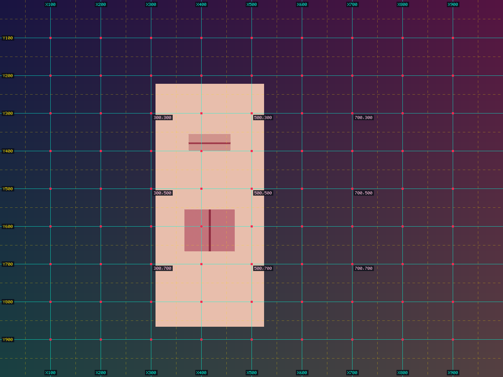
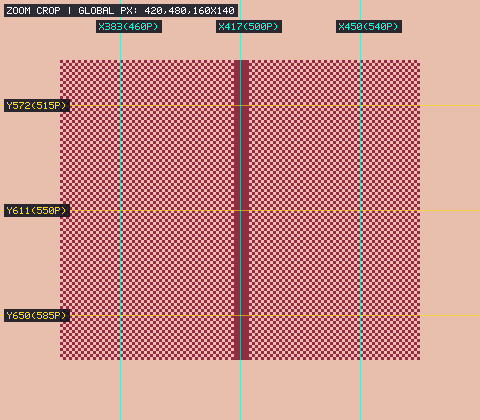
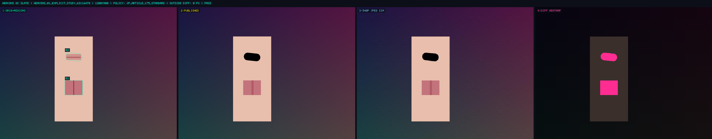
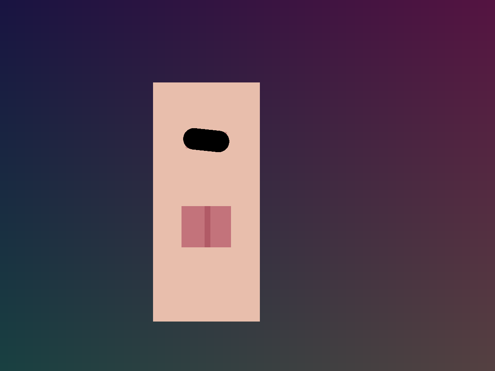
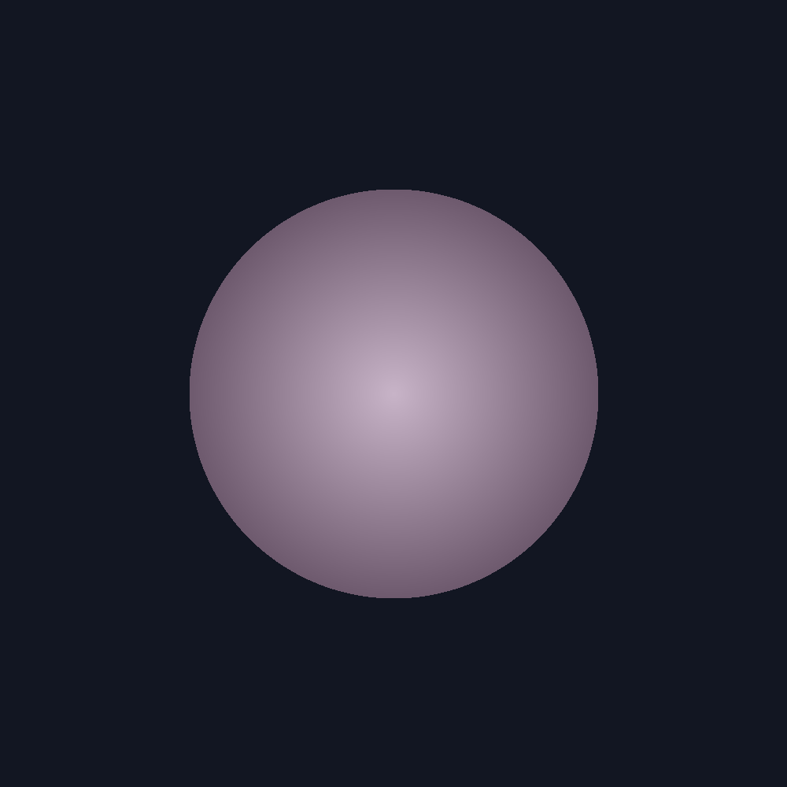
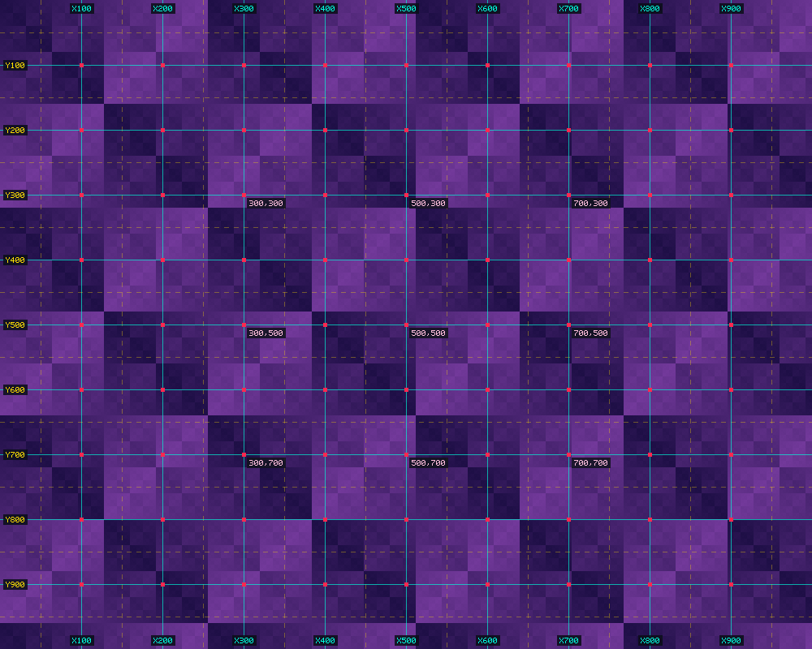

<div align="center">

# `heav3ns-censor` (v4.0)

**Deterministic Localized Image Redaction, Dataset Sanitization & Artistic Post-Production Studio Engine**  
*Built in Rust for **AI Safety & Security Researchers**, **Multimodal Dataset Curators**, **Digital Artists (`EGG`)**, **Studio Directors (`MAJO`)**, and **Autonomous Agents (`Deputy Gemini`)***

[](Cargo.toml)
[](CHANGELOG.md)
[](LICENSE)
[](src/mcp.rs)
[](docs/knowledgebase/03-dataset-cleaning-and-ai-safety-research.md)
[-3fb950.svg)](docs/whitepaper/TECHNICAL_WHITEPAPER.md)

**[🔬 Dataset & Safety Research](docs/knowledgebase/03-dataset-cleaning-and-ai-safety-research.md)** • **[🎨 Artist & Studio Handoff](docs/stakeholder-handoff/STAKEHOLDER_HANDOFF.md)** • **[🤖 Agent Onboarding](docs/onboarding/AGENT_ONBOARDING.md)** • **[🛠️ Developer Guide](docs/onboarding/DEVELOPER_ONBOARDING.md)** • **[Philosophy](docs/philosophy/PHILOSOPHY.md)** • **[Whitepaper](docs/whitepaper/TECHNICAL_WHITEPAPER.md)** • **[Docs Portal](docs/README.md)** • **[ADRs](docs/adrs/README.md)** • **[Playbooks](docs/playbooks/README.md)** • **[Postmortems](docs/postmortems/README.md)**

</div>

---

## Start Here: 60-Second Role-Based Onboarding & Handoff Hub

Select your persona below or run `./target/release/heav3ns-censor onboard --role <role>` for a live, context-aware handoff packet:

| Persona | Primary Use Case & Handoff Goal | Dedicated Guide | Live CLI Self-Onboarding |
| :--- | :--- | :--- | :--- |
| **🔬 AI Safety & Dataset Researcher** | Clean vision-language datasets without sample-dropping bias or diffusion hallucination; export paired counterfactual splits (`ledger/dataset_manifest.jsonl`) with `COCO`, `Normalized1000`, & `YOLO` boxes. | **[Dataset & Safety Research Guide &rarr;](docs/knowledgebase/03-dataset-cleaning-and-ai-safety-research.md)**<br/>*(+ [`Technical Whitepaper`](docs/whitepaper/TECHNICAL_WHITEPAPER.md) & [`DATASET_CARD.md`](ledger/DATASET_CARD.md))* | `./target/release/heav3ns-censor onboard --role researcher` |
| **🎨 Artist & Studio Director** (**EGG**, Principal Artist & **MAJO**, Executive Chair) | Produce non-destructive Japanese-style publication editions (`assets/published/`), A/B compare Original vs. Published (`[o]` key) in [`ledger/dashboard.html`](ledger/dashboard.html), and review escalations in [`escalations_review.md`](ledger/escalations_review.md). | **[Stakeholder Handoff Guide &rarr;](docs/stakeholder-handoff/STAKEHOLDER_HANDOFF.md)**<br/>*(+ [`Artistic Philosophy`](docs/philosophy/PHILOSOPHY.md))* | `./target/release/heav3ns-censor onboard --role stakeholder` |
| **🤖 Autonomous AI Agent** (`Deputy Gemini` / MCP Client) | Ingest `assets/inbox/`, inspect VLM `Normalized1000` coordinate grids & $3\times$ zoom-crops, execute localized SDF redaction or escalate ambiguity, and verify with `doctor --fix`. | **[Agent Onboarding Guide &rarr;](docs/onboarding/AGENT_ONBOARDING.md)**<br/>*(+ [`AGENTS.md`](AGENTS.md) & [`SKILL.md`](.agents/skills/heav3ns-censor-operator/SKILL.md))* | `./target/release/heav3ns-censor onboard --role agent` |
| **🛠️ Rust Systems Developer** | Explore the 6-module Rust codebase (`src/`), run the 9 mathematical & safety invariant tests (`cargo test --release`), or extend SDF primitives and policy profiles. | **[Developer Onboarding Guide &rarr;](docs/onboarding/DEVELOPER_ONBOARDING.md)**<br/>*(+ [`CONTRIBUTING.md`](CONTRIBUTING.md) & [`ADRs`](docs/adrs/README.md))* | `./target/release/heav3ns-censor onboard --role developer` |

---

## Why `heav3ns-censor`? (Advancing Safety Research & Artistic Post-Production)

Both **multimodal AI dataset curation** and **digital illustration post-production** suffer from a critical gap in existing tooling:

1. **In Dataset Cleaning & AI Safety Research:** Bulk NSFW classifiers delete entire images when a small localized region triggers a filter (*sample-dropping bias*), systematically purging figurative art, classical painting, and anatomical studies from training corpora. Conversely, scrubbing regions with latent diffusion inpainting alters every pixel via VAE decoding and injects synthetic hallucinated textures (*distribution poisoning*).
2. **In Artistic Rendering & Publication Compliance:** Illustrators (**EGG**) and studio directors (**MAJO**) require localized Japanese-style obscuration (Penal Code Article 175 *bokashi* mosaic, *kuro-nuri* `#000000` / *shiro-nuri* `#FFFFFF` graphic bars, feathered Gaussian blur) that **never** touches brushwork, color grading, or alpha transparency outside the exact mask, and mathematically proves that redactions survive `1080p` social compression and `540p` mobile thumbnail downscaling.

### Industry & Research Comparison Matrix

| Dimension | Bulk Classifier Filtering (Sample Dropping) | Generative Diffusion Inpainting | Manual Raster Editing (Photoshop / CSP) | **`heav3ns-censor` (v4.0 Rust Engine)** |
| :--- | :---: | :---: | :---: | :---: |
| **Exterior Pixel Preservation** | N/A (Deletes image) | ❌ Corrupts entire canvas via VAE decode | ⚠️ Prone to layer/export drift | ✅ **100% Bit-Exact (`0` diff px outside SDF mask)** |
| **Preserves Figurative Art Corpora?** | ❌ Purges artistic nudity as false positives | ⚠️ Overwrites original brushwork | ✅ Manual human triage | ✅ **3-Way Triage (`Verified`, `ApprovedOriginal`, `Escalated`)** |
| **Zero Synthetic Hallucinations** | ✅ | ❌ Injects latent diffusion artifacts | ✅ | ✅ **Deterministic Mathematical Operators Only** |
| **Multi-Scale `540p` / `1080p` JPEG Proof** | ❌ | ❌ | ❌ Visual guesswork | ✅ **Automated Mean + $P_{95}$ Peak Gradient Verification** |
| **Structured ML Dataset Export** | ❌ | ❌ | ❌ | ✅ **`dataset_manifest.jsonl` (`COCO` + `Normalized1000` + `YOLO`)** |
| **Autonomous VLM Agent & Studio UX** | ❌ | ❌ | ❌ Manual labor | ✅ **13-Tool MCP Server + Interactive `dashboard.html`** |

---

## Visual Pipeline Showcase (Coarse-to-Fine VLM Grounding & 4-Panel QC Slate)

| Stage 1: VLM Coordinate Grid (`*_inspect_grid.png`) | Stage 2: 3x Magnified Zoom-Crop (`*_zoom_crop.png`) |
| :---: | :---: |
|  |  |
| *Burned-in `Normalized1000` cyan `X100..X900` & yellow `Y100..Y900` rulers + pink interior `(300,300)`..`(700,700)` anchors.* | *3x nearest-neighbor magnification (`inspect --crop`) with burned-in global pixel coordinates (`X420..X580`).* |

### Stage 3: Automated 4-Panel Broadcast QC Slate (`*_contact_sheet.png`)
Every `execute` run automatically generates a 4-panel verification contact sheet comparing **(1) Original + Exact SDF Contours**, **(2) Published Censored Edition**, **(3) 540p Thumbnail JPEG Simulation (`Q75`)**, and **(4) Bit-Exact Modification Heatmap** (`0` exterior diff pixels):



### Stage 4: The 3 Triage Archetypes (Surgical Redaction vs. Artistic Preservation vs. Quarantine)
`heav3ns-censor` never blindly censors every instance of nudity. It enforces a strict three-way triage across incoming master illustrations and research datasets:

| 1. `Verified` (Surgical Region Redaction) | 2. `ApprovedOriginal` (Artistic Nudity Pass) | 3. `Escalated` (Quarantined for Human Review) |
| :---: | :---: | :---: |
|  |  |  |
| **`heav3ns_01_explicit_study`**<br/>Applied `14px` Article 175 `Mosaic` (`r1`) + $+6^\circ$ rotated `Pill` `SolidBar` (`r2`). `1.60%` canvas redacted; **`98.40%` 100% bit-identical**. Safe for release (`true`). | **`heav3ns_02_artistic_silhouette`**<br/>Classical silhouette with zero explicit genital detail. Approved untouched (**`0.00%` pixels modified**; `SHA-256` identical to master). Safe for release (`true`). | **`heav3ns_03_biomech_ambiguity`**<br/>Abstract biomechanical groin core. Automatically revoked from `published/` and isolated to [`ledger/escalations_review.md`](ledger/escalations_review.md). Safe for release (`false`). |

---

## System Architecture

```
                         ┌─────────────────────────────────────────┐
                         │   Incoming Artwork / Dataset Corpus     │
                         │              assets/inbox/              │
                         └────────────────────┬────────────────────┘
                                              │
                                              ▼
┌─────────────────────────────────────────────────────────────────────────────────────────┐
│                         1. CRYPTOGRAPHIC ARCHIVE & VLM GROUNDING                        │
│  • Preserves untouched master in `assets/originals/` with SHA-256 verification.         │
│  • Renders `*_inspect_grid.png` with burned-in Normalized1000 cyan/yellow ruler badges, │
│    pink interior anchors (300/500/700), & automatic high-frequency hotspot detection.   │
│  • Supports 3x nearest-neighbor zoom-crop grids (`inspect --crop`) with global coords.  │
└─────────────────────────────────────────────┬───────────────────────────────────────────┘
                                              │
                 ┌────────────────────────────┼────────────────────────────┐
                 ▼                            ▼                            ▼
┌────────────────────────────────┐ ┌──────────────────────┐ ┌─────────────────────────────┐
│  2A. SURGICAL REDACTION        │ │ 2B. ARTISTIC PASS    │ │ 2C. AMBIGUITY QUARANTINE    │
│  `execute` (`mosaic`,          │ │ `approve-original`   │ │ `escalate`                  │
│  `solid_bar`, `gaussian_blur`) │ │ Bit-identical export │ │ Revokes any published file; │
│  Inverse-rotated SDF (`rect`,  │ │ for classical/non-   │ │ isolates asset & logs to    │
│  `ellipse`, `pill` + `@angle`) │ │ explicit nudity.     │ │ `escalations_review.md`.    │
└────────────────┬───────────────┘ └──────────┬───────────┘ └──────────────┬──────────────┘
                 │                            │                            │
                 └────────────────────────────┼────────────────────────────┘
                                              ▼
┌─────────────────────────────────────────────────────────────────────────────────────────┐
│         3. MULTI-SCALE VERIFICATION, STUDIO QC SLATE & ML DATASET JSONL EXPORT          │
│  • Verifies `non_censored_pixel_diff_count == 0` (100% bit-exact exterior preservation) │
│  • Verifies Mean + P95 Peak gradient suppression across Native, 1080p Q85, & 540p Q75   │
│  • Generates 4-Panel Broadcast QC Slate (`*_contact_sheet.png`) & `dashboard.html`      │
│  • Exports `ledger/dataset_manifest.jsonl` (COCO + Normalized1000 + YOLO) & Dataset Card│
└─────────────────────────────────────────────────────────────────────────────────────────┘
```

---

## Installation & Dual-Track Quickstarts

### Build from Source
Requires Rust `1.75+` (`cargo`):

```bash
git clone https://github.com/CardSorting/heav3ns-censor.git
cd heav3ns-censor
cargo test --release
cargo build --release
```

### Track A: AI Safety & Dataset Cleaning Workflow (`export-dataset`)

```bash
# 1. Batch-ingest raw corpus and render VLM coordinate grids + high-frequency hotspot hints
./target/release/heav3ns-censor batch-prepare

# 2. Apply surgical localized redaction, preserve non-explicit art, or quarantine ambiguous items
./target/release/heav3ns-censor execute --asset-id heav3ns_01 \
  --region "r1=mosaic:440,500,120,100:pixels:rect:14:0:explicit_lower_anatomy" \
  --region "r2=solid_bar:444,314,112,52:pixels:pill:auto@6.0:0:kuro_nuri_cleft_bar"
./target/release/heav3ns-censor approve-original --asset-id heav3ns_02 \
  --classification artistic_nudity_pass --rationale "Classical dorsal silhouette; preserve untouched."
./target/release/heav3ns-censor escalate --asset-id heav3ns_03 \
  --category "stylized_anatomy_ambiguity" --reason "Quarantine for human safety review."

# 3. Export compliance-verified JSONL dataset manifest (--safe-only excludes quarantined items)
./target/release/heav3ns-censor export-dataset --safe-only
```

Load the exported [`ledger/dataset_manifest.jsonl`](ledger/dataset_manifest.jsonl) directly in Python / PyTorch / HuggingFace `datasets`:

```python
import json
from pathlib import Path

records = [json.loads(line) for line in Path("ledger/dataset_manifest.jsonl").read_text().splitlines()]
for rec in records:
    print(rec["asset_id"], rec["curation_action"], f"Preserved: {rec['exterior_preservation_ratio']*100:.2f}%")
    for ann in rec["annotations"]:
        print("  COCO xywh (px):", ann["bbox_xywh_px"], "| VLM norm1000:", ann["bbox_xyxy_norm1000"], "| YOLO:", ann["bbox_cxcywh_norm01"])
```

### Track B: Artistic Rendering & Studio Post-Production Workflow (`EGG` & `MAJO`)

```bash
# 1. Inspect a 3x magnified zoom-crop with burned-in global pixel coordinates
./target/release/heav3ns-censor inspect --asset-id heav3ns_01 --crop "420,480,160,140:pixels"

# 2. Incrementally adjust or test a region (--append, --remove-region, --dry-run)
./target/release/heav3ns-censor execute --asset-id heav3ns_01 --append \
  --region "r2=solid_bar:444,314,112,52:pixels:pill:auto@6.0:0:kuro_nuri_cleft_bar"

# 3. Print the complete diagnostic & handoff card for any asset
./target/release/heav3ns-censor explain --asset-id heav3ns_01

# 4. Run the 9-point cryptographic SHA-256, bit-exact preservation, & orphan-hygiene audit
./target/release/heav3ns-censor doctor --fix
```

Then open **[`ledger/dashboard.html`](ledger/dashboard.html)** in any browser to:
- Press **`[o]`** (or click **`[o] A/B Compare Original`**) on any asset card to toggle instantly between the Published Edition and the Untouched Master Archive.
- Click and drag a bounding box directly on any image to measure exact coordinates and generate a 1-click CLI command.

---

## CLI Command & Region Shorthand Reference

### CLI Subcommands

| Subcommand | Purpose |
| :--- | :--- |
| `onboard [--role <role>]` | Outputs a role-tailored (`researcher`, `stakeholder`, `agent`, `developer`, `all`) onboarding packet. |
| `explain --asset-id <id>` | Outputs a complete per-asset diagnostic, cryptographic integrity, and handoff card with pre-filled CLI commands. |
| `status` | Outputs workspace pipeline queues, ledger paths, and `next_recommended_action`. |
| `batch-prepare` | Ingests all new `assets/inbox/` files, archives SHA-256 masters, and renders VLM coordinate grids + hotspots. |
| `inspect --asset-id <id> [--crop <spec>]` | Generates coordinate inspection grid and optional $3\times$ nearest-neighbor zoom-crop with global pixel rulers. |
| `execute --asset-id <id> --region <spec>` | Applies localized SDF censorship (`--append`, `--remove-region`, `--dry-run`) and verifies multi-scale JPEG survival. |
| `approve-original --asset-id <id>` | Approves non-explicit artistic nudity untouched (`100%` bit-identical export to `assets/published/`). |
| `escalate --asset-id <id>` | Quarantines ambiguous assets to `ledger/escalations_review.md` and revokes any prior `published/` file. |
| `export-dataset [--safe-only]` | Exports `ledger/dataset_manifest.jsonl` (`COCO` + `Normalized1000` + `YOLO`) and `ledger/DATASET_CARD.md`. |
| `doctor [--fix]` | Runs the 9-point cryptographic `SHA-256`, bit-exact preservation, escalation-isolation, and orphan-hygiene audit. |

### Region Shorthand Syntax (`--region`)

```text
[id=]method:x,y,w,h[:unit][:shape][:param[@angle_deg]][:feather][:label]
```

| Field | Values | Description |
| :--- | :--- | :--- |
| `id=` | Optional string (`r1=`, `cleft=`) | Explicit region ID for incremental `--append` upsert or `--remove-region`. |
| `method` | `mosaic`, `solid_bar`, `gaussian_blur` | Spatial obscuration algorithm. |
| `x,y,w,h` | `f32,f32,f32,f32` | Unrotated region bounding box coordinates. |
| `unit` | `pixels`, `normalized1000`, `percent` | Coordinate system (`normalized1000` matches burned-in `100..900` grid badges). |
| `shape` | `rect`, `ellipse`, `pill` | Analytical SDF shape (`pill` is a round-capped stadium capsule). |
| `param[@angle]` | e.g., `14`, `auto@6.0`, `#000000@-15`, `12.0` | Block size (`mosaic`), hex/`auto` color (`solid_bar`), or $\sigma$ (`gaussian_blur`), plus optional rotation angle in degrees. |
| `feather` | Integer pixels (`0` default) | Smoothstep edge feathering (clamped to $\le 45\%$ of minor half-axis). |
| `label` | String identifier | Human-readable audit & dataset annotation label. |

---

## Model Context Protocol (MCP) Server Integration (13 Tools)

`heav3ns-censor` includes a native JSON-RPC 2.0 `stdio` MCP server (`./target/release/heav3ns-censor mcp`), pre-configured in [`.agents/mcp_config.json`](.agents/mcp_config.json):

| MCP Tool Name | Description |
| :--- | :--- |
| `heav3ns_onboard` | Returns a role-tailored (`agent`, `researcher`, `developer`, `stakeholder`, `all`) onboarding packet. |
| `heav3ns_explain_asset` | Returns a complete diagnostic, cryptographic integrity, and handoff explanation card for a single asset. |
| `heav3ns_export_dataset` | Exports `ledger/dataset_manifest.jsonl` (`COCO` + `Normalized1000` + `YOLO`) and `ledger/DATASET_CARD.md` (`safe_only: bool`). |
| `heav3ns_status` | Returns pipeline queues, ledger paths, and `next_recommended_action`. |
| `heav3ns_doctor` | Runs the 9-point cryptographic SHA-256, preservation, and orphan-hygiene audit (`fix: bool`). |
| `heav3ns_batch_prepare` | Ingests all new `inbox/` files and renders VLM inspection grids + hotspot hints in one call. |
| `heav3ns_ingest` | Ingests a specific file or scans `assets/inbox/`. |
| `heav3ns_inspect` | Generates coordinate inspection grid and optional $3\times$ magnified zoom-crop (`crop`). |
| `heav3ns_execute_censorship` | Executes localized censorship with `append`, `remove_region_ids`, and `dry_run` support. |
| `heav3ns_approve_original` | Approves artistic/suggestive nudity untouched with SHA-256 verification. |
| `heav3ns_escalate` | Quarantines ambiguous assets to `ledger/escalations_review.md` and revokes any published file. |
| `heav3ns_reset_asset` | Resets an asset to `PendingInspection` while preserving its untouched original. |
| `heav3ns_policy_guide` | Outputs Japanese Article 175 and platform policy profiles as structured JSON. |

---

## Core Mathematical & Engineering Guarantees

| Capability | Mathematical Formulation | Implementation |
| :--- | :--- | :--- |
| **Bit-Exact Exterior Preservation** | $\forall (x,y) \notin \bigcup_k \text{supp}(\alpha_k),\; I_{\text{pub}}(x,y) \equiv I_0(x,y)$ (including alpha transparency) | [`src/engine.rs`](src/engine.rs) |
| **Inverse-Rotated Analytical SDFs** | Exact signed distance for rotated `Rect`, `Ellipse`, and round-capped `Pill` capsules with dynamic enclosing AABB $(W_{\text{enc}}, H_{\text{enc}})$ | [`src/models.rs`](src/models.rs) |
| **Immutable-Source Remainder Mosaic** | Samples strictly from $I_0$; enforces Article 175 block size $b \ge \lceil \max(W,H)/100 \rceil$ and folds remainder strips ($< 0.5b$) into terminal cells | [`src/engine.rs`](src/engine.rs) |
| **Luminance-Adaptive Graphic Bars** | Supports `#000000` (*kuro-nuri*), `#FFFFFF` (*shiro-nuri*), or `auto` ($\bar{Y} < 90 \implies \text{\#FFFFFF}$, else $\text{\#000000}$) | [`src/engine.rs`](src/engine.rs) |
| **Multi-Scale Fractional Verification** | Evaluates $1\text{px}$-eroded interior Mean & $P_{95}$ Peak suppression across Native, `1080p` (`Q85`), and `540p` (`Q75`) at fractional steps $\Delta x \bmod (b \cdot s)$ | [`src/engine.rs`](src/engine.rs) |
| **Transactional Workspace Hygiene** | `WorkspaceLock` (`ledger/.ledger.lock`) + atomic temp-rename + `BTreeMap` ledger + 9-check `doctor --fix` audit | [`src/workspace.rs`](src/workspace.rs) |

---

## Empirical Verification & Benchmark Suite (9 Automated Tests)

Run `cargo test --release` to execute all 9 automated mathematical, dataset-curation, and state-hygiene unit tests:

| Test Suite | Invariant Verified | Status |
| :--- | :--- | :---: |
| `test_mosaic_remainder_strip_pooling_and_peak_suppression` | Non-multiple mosaic ($103\times97\text{px}, b=12$) folds $1\text{px}$ remainder strip; Mean & $P_{95} > 95\%$ | **PASS** |
| `test_rotated_pill_kuro_nuri_and_angled_mosaic` | $+35^\circ$ rotated `Pill` bar & $-20^\circ$ `Ellipse` mosaic without AABB clipping; `0` exterior diff px | **PASS** |
| `test_transparent_png_alpha_preservation` | Semi-transparent character layer ($\alpha = 128$) preserves exact alpha channel inside mosaic | **PASS** |
| `test_escalation_isolation_revokes_published_file` | Transitioning `ApprovedOriginal -> Escalated` revokes and deletes `published/` artifact | **PASS** |
| `test_auto_contrast_solid_bar_luminance_adaptation` | `color="auto"` selects `#FFFFFF` (*shiro-nuri*) on dark luma and `#000000` (*kuro-nuri*) on bright luma | **PASS** |
| `test_excessive_feather_clamping_preserves_opaque_core` | Requesting `feather=200px` on a $60\times60\text{px}$ box clamps feather to $\le 45\%$ of half-axis | **PASS** |
| `test_degenerate_tiny_region_rejected_by_verifier` | Degenerate $2\times2\text{px}$ region (`0` interior eroded samples) hard-fails verification (`passed == false`) | **PASS** |
| `test_incremental_region_append_upsert_remove_and_dry_run` | Verifies `--append`, `id=` in-place upsert, `--remove-region`, `--dry-run`, `onboard`, and `explain` | **PASS** |
| `test_dataset_cleaning_jsonl_export_and_safety_filtering` | Verifies `export-dataset` (`COCO` + `Normalized1000` + `YOLO` boxes) and `--safe-only` quarantine filtering | **PASS** |

---

## Documentation & Research Architecture ([`docs/README.md`](docs/README.md))

1. **Foundational Tri-Pillar Documents:**
   - **[Artistic Preservation & Post-Production Philosophy](docs/philosophy/PHILOSOPHY.md)**
   - **[Executive & Studio Stakeholder Handoff Guide](docs/stakeholder-handoff/STAKEHOLDER_HANDOFF.md)**
   - **[Technical Whitepaper](docs/whitepaper/TECHNICAL_WHITEPAPER.md)**
2. **Domain Knowledgebase ([`docs/knowledgebase/INDEX.md`](docs/knowledgebase/INDEX.md)):**
   - **[`KB-01`: Japanese Penal Code Article 175 & Cross-Platform Censorship Standards](docs/knowledgebase/01-japanese-article-175-and-platform-standards.md)**
   - **[`KB-02`: Coordinate Systems & Multimodal VLM Grounding](docs/knowledgebase/02-coordinate-systems-and-vlm-grounding.md)**
   - **[`KB-03`: Dataset Cleaning, Multimodal AI Safety, & Non-Destructive Artistic Post-Production](docs/knowledgebase/03-dataset-cleaning-and-ai-safety-research.md)**
3. **Architecture Decision Records ([`docs/adrs/README.md`](docs/adrs/README.md)):** [`ADR-0001`](docs/adrs/ADR-0001-deterministic-pixel-engine-over-generative-inpainting.md) • [`ADR-0002`](docs/adrs/ADR-0002-immutable-source-sampling-and-inverse-rotated-sdf-masks.md) • [`ADR-0003`](docs/adrs/ADR-0003-multiscale-jpeg-resilience-and-p95-peak-verification.md) • [`ADR-0004`](docs/adrs/ADR-0004-atomic-btree-ledger-and-dual-cli-mcp-interface.md)
4. **Operational Playbooks ([`docs/playbooks/README.md`](docs/playbooks/README.md)):** [`PLAYBOOK-01`](docs/playbooks/PLAYBOOK-01-autonomous-batch-ingestion-and-vlm-triage.md) • [`PLAYBOOK-02`](docs/playbooks/PLAYBOOK-02-precision-censorship-and-incremental-region-editing.md) • [`PLAYBOOK-03`](docs/playbooks/PLAYBOOK-03-ambiguity-escalation-revocation-and-artist-review.md) • [`PLAYBOOK-04`](docs/playbooks/PLAYBOOK-04-workspace-doctor-audit-and-incident-recovery.md)
5. **Engineering Postmortems ([`docs/postmortems/README.md`](docs/postmortems/README.md)):** [`PM-001`](docs/postmortems/PM-001-mosaic-remainder-strip-high-frequency-edge-leakage.md) • [`PM-002`](docs/postmortems/PM-002-rotated-aabb-clipping-and-background-gradient-dilution.md) • [`PM-003`](docs/postmortems/PM-003-downscaled-540p-fractional-mosaic-grid-misalignment.md) • [`PM-004`](docs/postmortems/PM-004-in-place-canvas-mutation-and-zero-sample-false-positives.md)

---

## Academic Citation (`BibTeX` & `CITATION.cff`)

This repository includes a machine-readable [`CITATION.cff`](CITATION.cff) file for GitHub, Zenodo, and Zotero integration. If you use `heav3ns-censor` for dataset cleaning, multimodal safety research, or artistic post-production, please cite:

```bibtex
@software{heav3ns_censor_2026,
  author       = {Deputy Gemini and EGG and MAJO},
  title        = {{heav3ns-censor: Deterministic Zero-Collateral Localized Image Obscuration with Multi-Scale Frequency-Domain and JPEG-Quantization Resilience Verification}},
  year         = {2026},
  version      = {4.0.0},
  publisher    = {HEAV3NS Post-Production Systems Research},
  license      = {MIT},
  url          = {https://github.com/CardSorting/heav3ns-censor}
}
```

---

## Open-Source Governance, Security, & MIT License

- **License:** Licensed under the **[MIT License](LICENSE)** (see [`LICENSE`](LICENSE) for full text).
- **Contributing:** See [`CONTRIBUTING.md`](CONTRIBUTING.md) for architectural invariants, test requirements, and ADR guidelines.
- **Governance:** See [`GOVERNANCE.md`](GOVERNANCE.md) for the Triad Studio & Open-Source Governance model (**MAJO**, **EGG**, **Deputy Gemini**, and community contributors).
- **Security Policy:** See [`SECURITY.md`](SECURITY.md) for cryptographic `SHA-256` master verification, escalation isolation guarantees, and vulnerability reporting.
- **Code of Conduct:** Governed by the Contributor Covenant v2.1 in [`CODE_OF_CONDUCT.md`](CODE_OF_CONDUCT.md).
- **Release History:** Tracked in [`CHANGELOG.md`](CHANGELOG.md).
