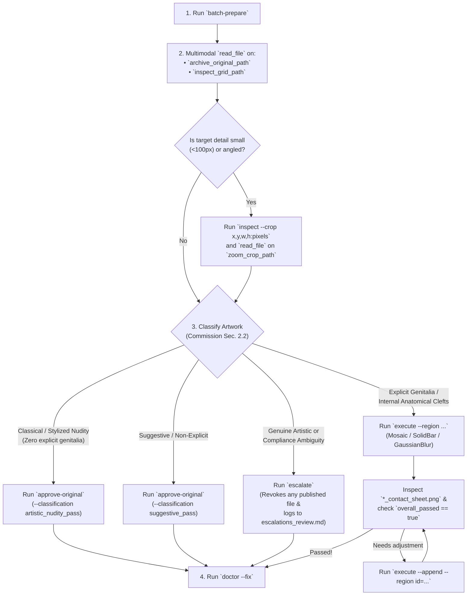
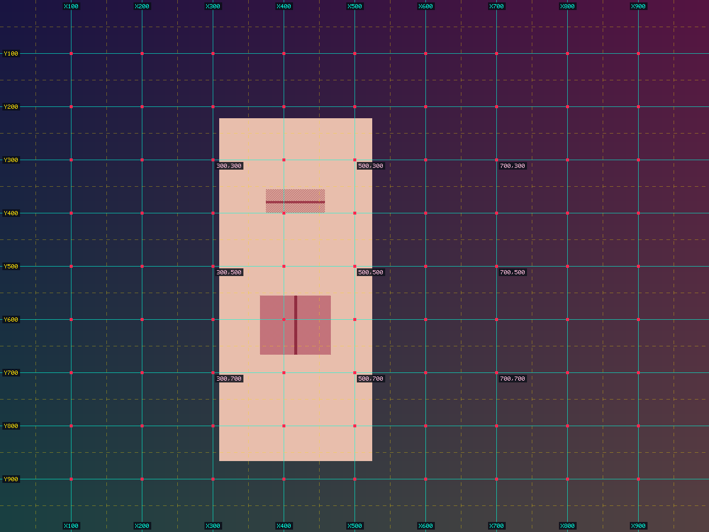
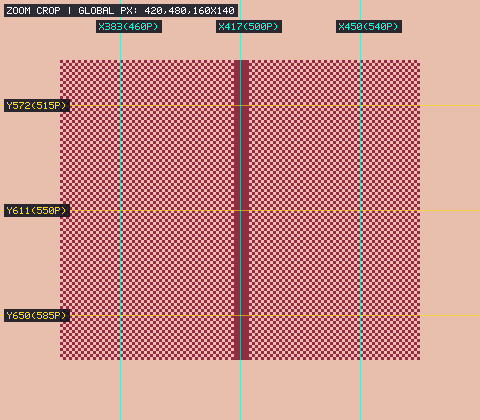
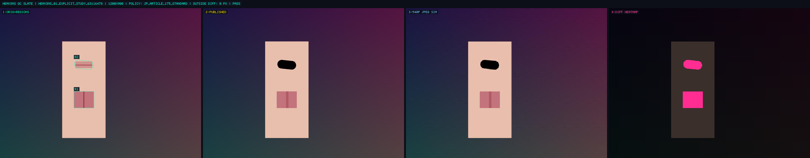

[🏠 Home (`README.md`)](../../README.md) &rsaquo; [📚 Knowledgebase (`INDEX.md`)](../knowledgebase/INDEX.md) &rsaquo; **🤖 Autonomous Agent Onboarding**

---

# Autonomous AI Agent Onboarding Guide (`Deputy Gemini` & Peer Agents)

**Document ID:** `DOC-ONBOARD-AGENT`  
**Engine Version:** `heav3ns-censor v4.0.0`  
**Target Persona:** Autonomous Coding & Multimodal Vision-Language Agents (`Deputy Gemini`, subagents, MCP clients)  

> [!IMPORTANT]
> **60-Second Self-Discovery Command:**  
> Whenever you wake up in a new session, run:
> ```bash
> ./target/release/heav3ns-censor onboard --role agent
> ```
> or call the MCP tool `heav3ns_onboard({"role": "agent"})`. It returns the live workspace status, active asset queues, and copy-pasteable commands tailored to the current ledger state.

---

## 1. End-to-End Autonomous Decision Tree

Follow this deterministic state machine for every artwork in `assets/inbox/`:



---

## 2. Visual Grounding Walkthrough (What You See via `read_file`)

### Step A: Reading the VLM Coordinate Inspection Grid (`*_inspect_grid.png`)
When `batch-prepare` or `inspect` runs, it generates a coordinate overlay with **cyan X-rulers (`X100..X900`)**, **yellow Y-rulers (`Y100..Y900`)**, and **pink interior anchors (`300,300`, `500,500`, `700,700`)** in `Normalized1000` space (`0..1000`):



### Step B: Reading the 3x Magnified Zoom-Crop (`*_zoom_crop.png`)
When you need sub-pixel precision for a narrow anatomical cleft or mosaic box, run:
```bash
./target/release/heav3ns-censor inspect --asset-id heav3ns_01 --crop "420,480,160,140:pixels"
```
The engine magnifies the region $3\times$ and burns the **exact global pixel coordinates (`X420..X580`, `Y480..Y620`)** directly onto the crop:



### Step C: Verifying the 4-Panel Broadcast QC Slate (`*_contact_sheet.png`)
After running `execute`, always view `assets/previews/<ASSET_ID>_contact_sheet.png` to confirm:
- **Panel 1 (Top-Left):** Original + target cyan contours (`Rect`, `Ellipse`, or `Pill`).
- **Panel 2 (Top-Right):** Published censored edition (`0` collateral pixel damage).
- **Panel 3 (Bottom-Left):** `540p` thumbnail JPEG simulation (`Q75`).
- **Panel 4 (Bottom-Right):** Bit-exact modification heatmap (modified pixels glowing cyan strictly inside the magenta target contour).



---

## 3. CLI vs. MCP Tool Mapping

You may operate `heav3ns-censor` via shell commands or MCP tools interchangeably:

| Workflow Step | CLI Command (`./target/release/heav3ns-censor ...`) | MCP Tool (`heav3ns-censor` server) |
| :--- | :--- | :--- |
| **Self-Onboard** | `onboard --role agent` | `heav3ns_onboard({"role": "agent"})` |
| **Check Queue** | `status` | `heav3ns_status({})` |
| **Batch Ingest & Grid** | `batch-prepare` | `heav3ns_batch_prepare({})` |
| **3x Zoom-Crop** | `inspect --asset-id <ID> --crop "x,y,w,h:pixels"` | `heav3ns_inspect({"asset_id": "<ID>", "crop": "..."})` |
| **Apply Censorship** | `execute --asset-id <ID> --region "..." [--append]` | `heav3ns_execute_censorship({"asset_id": "<ID>", "regions": [...], "append": true})` |
| **Approve Untouched** | `approve-original --asset-id <ID> --rationale "..."` | `heav3ns_approve_original({"asset_id": "<ID>", "classification": "...", "rationale": "..."})` |
| **Escalate Ambiguity** | `escalate --asset-id <ID> --category "..." --reason "..."` | `heav3ns_escalate({"asset_id": "<ID>", "category": "...", "reason": "..."})` |
| **Workspace Audit** | `doctor --fix` | `heav3ns_doctor({"fix": true})` |

---

**Next Steps:** [🛠️ Developer Onboarding (`DEVELOPER_ONBOARDING.md`)](DEVELOPER_ONBOARDING.md) • [📋 Operational Playbooks (`docs/playbooks/`)](../playbooks/PLAYBOOK-01-autonomous-batch-ingestion-and-vlm-triage.md) • [🏛️ Executive Handoff (`STAKEHOLDER_HANDOFF.md`)](../stakeholder-handoff/STAKEHOLDER_HANDOFF.md)

