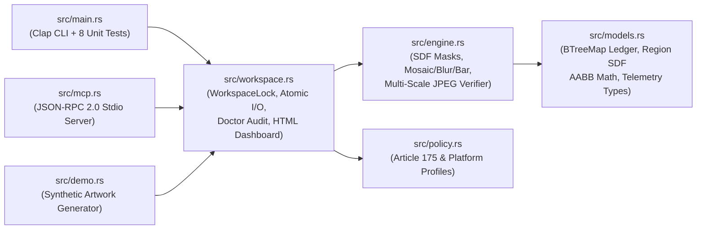

[🏠 Home (`README.md`)](../../README.md) &rsaquo; [📚 Knowledgebase (`INDEX.md`)](../knowledgebase/INDEX.md) &rsaquo; **🛠️ Developer & Researcher Onboarding**

---

# Human Developer & Systems Researcher Onboarding Guide

**Document ID:** `DOC-ONBOARD-DEV`  
**Engine Version:** `heav3ns-censor v4.0.0`  
**Target Persona:** Rust Systems Engineers, Computer Vision Researchers, & Open-Source Contributors  

---

## 1. 5-Minute Build, Test, & Demo Walkthrough

```bash
# 1. Clone and run the 8 mathematical & state-hygiene unit tests
git clone https://github.com/CardSorting/heav3ns-censor.git
cd heav3ns-censor
cargo test --release

# 2. Build the optimized release binary
cargo build --release

# 3. Print your live developer onboarding packet
./target/release/heav3ns-censor onboard --role developer

# 4. Run the cryptographic & workspace hygiene audit
./target/release/heav3ns-censor doctor --fix
```

---

## 2. Codebase Architecture & Module Map (`src/`)

The entire `heav3ns-censor` engine is contained in **6 focused, zero-unsafe Rust modules** (~3,500 LOC total):



| File | Responsibility | Key Functions / Types |
| :--- | :--- | :--- |
| [`src/models.rs`](../../src/models.rs) | Data structures, deterministic `BTreeMap` ledger, and enclosing AABB geometry | `Ledger`, `AssetRecord`, `CensorshipRegion::resolve_enclosing_aabb`, `RegionShape` (`Rect`, `Ellipse`, `Pill`) |
| [`src/policy.rs`](../../src/policy.rs) | Japanese Penal Code Article 175 ($\max(W,H)/100$) & platform policy profiles | `get_policy_guides`, `recommended_mosaic_block_size` |
| [`src/engine.rs`](../../src/engine.rs) | Core pixel engine, inverse-rotated analytical SDFs, spatial filters, and multi-scale verifier | `region_mask_alpha`, `apply_censorship_regions`, `verify_censored_edition`, `generate_inspection_grid`, `generate_zoom_crop_grid` |
| [`src/workspace.rs`](../../src/workspace.rs) | Transactional asset lifecycle, `WorkspaceLock`, atomic temp-rename writes, `doctor`, and HTML dashboard | `Workspace::batch_prepare`, `execute_censorship_with_options`, `escalate_asset`, `run_doctor`, `generate_dashboard_html` |
| [`src/mcp.rs`](../../src/mcp.rs) | Native Model Context Protocol (`2024-11-05`) JSON-RPC 2.0 `stdio` server | `run_mcp_stdio_server`, `mcp_tool_definitions`, `dispatch_tool_call` |
| [`src/main.rs`](../../src/main.rs) | CLI parser (`clap`), `--region` shorthand parser, and unit test suite | `parse_shorthand_region`, `Commands`, `mod tests` |

---

## 3. How to Extend the Engine (Common Recipes)

### Recipe A: Adding a New Policy Profile (5 Minutes)
1. Open [`src/policy.rs`](../../src/policy.rs) and add a new `PolicyProfile` struct entry in `get_policy_guides()`.
2. Update `recommended_mosaic_block_size()` if the platform requires a custom block-sizing ratio.
3. Document the profile in [`docs/knowledgebase/01-japanese-article-175-and-platform-standards.md`](../knowledgebase/01-japanese-article-175-and-platform-standards.md).

### Recipe B: Adding a New Geometric SDF Primitive (15 Minutes)
1. Add the variant to `RegionShape` in [`src/models.rs`](../../src/models.rs).
2. Add the signed distance formula $d(u, v)$ in `region_mask_alpha()` in [`src/engine.rs`](../../src/engine.rs#L12-L63) (convention: $d \le 0$ inside the shape, $d > 0$ outside).
3. Map the CLI shorthand name in `parse_shorthand_region()` in [`src/main.rs`](../../src/main.rs#L168-L276).
4. Add a unit test in `src/main.rs` verifying `non_censored_pixel_diff_count == 0` and `overall_passed == true`.

---

## 4. Deep-Dive Engineering Reading List

Before modifying the spatial kernels in `src/engine.rs`, read our 4 engineering postmortems to understand the subtle mathematical traps we already solved:
1. **[`PM-001`: Mosaic Remainder-Strip High-Frequency Edge Leakage](../postmortems/PM-001-mosaic-remainder-strip-high-frequency-edge-leakage.md)** — Why $W_r \bmod b \neq 0$ leaks 1–3px strips unless folded into adjacent cells.
2. **[`PM-002`: Rotated AABB Clipping & Background Gradient Dilution](../postmortems/PM-002-rotated-aabb-clipping-and-background-gradient-dilution.md)** — Why rotated bars require dynamic enclosing AABBs and $1\text{px}$-eroded mask verification.
3. **[`PM-003`: Downscaled 540p Fractional Mosaic Grid Misalignment](../postmortems/PM-003-downscaled-540p-fractional-mosaic-grid-misalignment.md)** — Why `540p` ($0.6\times$) verification of a $14\text{px}$ mosaic must track fractional $8.4\text{px}$ step intervals.
4. **[`PM-004`: In-Place Canvas Mutation & Zero-Sample False Positives](../postmortems/PM-004-in-place-canvas-mutation-and-zero-sample-false-positives.md)** — Why all spatial kernels must sample strictly from the immutable `original` buffer.

---

**Next Steps:** [📄 Technical Whitepaper (`TECHNICAL_WHITEPAPER.md`)](../whitepaper/TECHNICAL_WHITEPAPER.md) • [📐 Architecture Decision Records (`docs/adrs/`)](../adrs/ADR-0001-deterministic-pixel-engine-over-generative-inpainting.md) • [🤝 Contributing Guide (`CONTRIBUTING.md`)](../../CONTRIBUTING.md)
