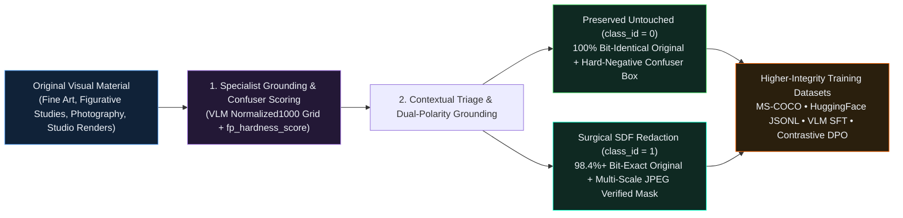

[🏠 Home (`README.md`)](../../README.md) &rsaquo; [📚 Docs (`docs/`)](../README.md) &rsaquo; [🚀 YC Package (`docs/yc/`)](README.md) &rsaquo; **00: Origin Insight & Research Thesis**

---

# Moving Upstream: Preservation-Aware Dataset Curation for Generative AI

**Founding Insight:** We are not building a downstream social-media content moderation tool. **We are solving a foundational data-quality, signal-preservation, and safety-alignment bottleneck in the generative AI training pipeline.**

---

## 1. The Two Catastrophic Failure Modes in Conventional Dataset Cleaning

As multimodal foundation models and image/video generators scale, the quality, diversity, and fidelity of their visual training corpora determine their ceiling. Yet conventional dataset cleaning pipelines rely on coarse, image-level NSFW classifiers (`NudeNet`, `OpenNSFW`, `LAION-Safety`) that fail to distinguish between **artistic representation, anatomical study, and content requiring restriction**.

This creates two structural failure modes across the AI industry:

### Failure Mode 1: Sample-Dropping Bias (`15%–40%` False-Positive Erasure)
When a legacy safety classifier triggers on a localized feature—or misclassifies a benign contour—the entire training sample is discarded:
- Classical figurative paintings and sculptures are systematically purged.
- Medical and artistic anatomical studies are removed.
- Dynamic human poses, complex skin-tone lighting, and overlapping garment folds become severely underrepresented.
- **Empirical Evidence:** Riccio et al. (*An Art-centric Perspective on AI-based Content Moderation of Nudity*, [`arXiv:2409.17156`](https://arxiv.org/abs/2409.17156)) proved that widely deployed NSFW classifiers suffer **`15%–40%` false-positive rates** on legitimate fine art and figurative imagery.

### Failure Mode 2: Reconstruction & Inpainting Distortion ("Habsburg AI")
When pipelines attempt to "heal" or modify a sensitive region using generative diffusion inpainting instead of dropping the sample:
- Passing the image through a Variational Autoencoder (VAE) encode-decode cycle mutates **100% of original canvas pixels** (`non_censored_pixel_diff_count > 0`) and shifts global chrominance.
- Diffusion reconstruction injects synthetic plastic textures, anatomical hallucinations, and seam artifacts into otherwise authentic human-authored data.
- Training subsequent generations of models on diffusion-inpainted corpora induces **Model Autophagy Disorder (MAD)**.

---

## 2. Our Solution: Preservation-Aware Contrastive Curation

Rather than treating an image as a single binary moderation decision (`keep` vs. `drop`) or corrupting it via generative reconstruction, **`heav3ns-censor v4.0`** evaluates visual material contextually and executes a 3-way preservation-aware pipeline:

---

## 3. Why the Artist-Founder Identity Is Central to the Thesis

Most AI safety and data engineers treat images as disposable tensors—which is why existing pipelines blindly delete classical art or smear diffusion noise over human brushwork.

Because **HEAV3NS** was founded by artists and systems builders (**EGG**, Principal Artist & Systems Architect; **MAJO**, Executive Chair), our entire architecture was engineered from day one around **absolute pixel preservation (`non_censored_pixel_diff_count == 0`)** and **distinguishing fine-art anatomy from explicit content**. What started as an uncompromising studio post-production standard is the exact mathematical primitive generative AI labs need to stop destroying visual human culture in their training sets.
