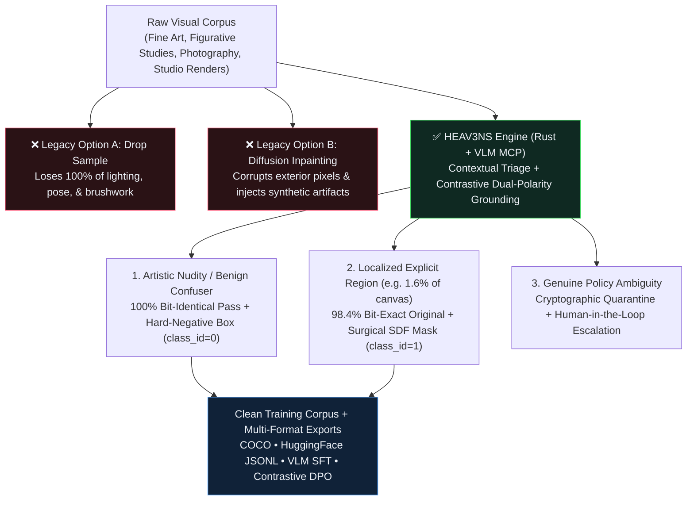
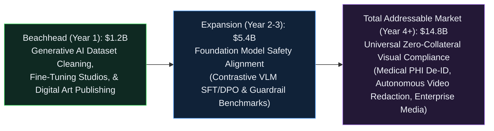

[🏠 Home (`README.md`)](../../README.md) &rsaquo; [📚 Docs (`docs/`)](../README.md) &rsaquo; [🚀 YC Package (`docs/yc/`)](README.md) &rsaquo; **02: YC Seed Pitch Deck (12 Slides)**

---

# HEAV3NS-CENSOR: Y Combinator Seed & Demo Day Pitch Deck

> **Interactive Browser Edition:** Open **[`pitch_deck.html`](pitch_deck.html)** in any browser for the full-screen keyboard-navigable (`←`/`→`, `f` fullscreen, `g` slide grid) presentation deck.

---

## Slide 1 — Title & 50-Character Hook

### **HEAV3NS** (`heav3ns-censor v4.0`)
**Preservation-aware visual dataset curation for AI.** *(49 characters)*

- **One-Line Thesis:** We stop generative AI training pipelines from destroying `30%+` of human visual culture in the name of safety—replacing coarse image deletion and synthetic inpainting with **surgical, bit-exact localized curation and contrastive false-positive suppression**.
- **Founding Leadership:**
  - **EGG** — Principal Artist & Systems Architect (Creator of `heav3ns-censor`)
  - **MAJO** — Executive Chair & Operations Strategy
- **Open-Source Core:** [`github.com/CardSorting/heav3ns-censor`](https://github.com/CardSorting/heav3ns-censor) (`Rust 2021` • `MIT License` • `15 MCP Tools` • `13 CLI Commands`)

---

## Slide 2 — The Problem: AI Safety Pipelines Are Blindly Erasing Visual Data

Modern multimodal AI labs and visual platforms face two catastrophic failure modes when cleaning visual training datasets:

1. **Failure Mode 1: Sample-Dropping Bias (`15%–40%` False-Positive Erasure)**
   - Legacy NSFW classifiers (`NudeNet`, `OpenNSFW`, `LAION-Safety`) make coarse, whole-image binary decisions.
   - As proven in [`arXiv:2409.17156`](https://arxiv.org/abs/2409.17156) (*An Art-centric Perspective on AI-based Content Moderation of Nudity*), these models misclassify **`15%–40%`** of classical sculpture, figurative painting, anatomical studies, and stylized linework.
   - **Consequence:** Billions of dollars of legitimate artistic composition, lighting, and human anatomy are deleted from training corpora.

2. **Failure Mode 2: Generative Inpainting Poisoning ("Habsburg AI")**
   - When pipelines attempt to "heal" a sensitive region using diffusion inpainting, the VAE encode-decode pass mutates surrounding pixels, shifts color profiles, and injects synthetic plastic textures.
   - **Consequence:** Training future models on diffusion-inpainted datasets causes **Model Autophagy Disorder (MAD)** and ruins fine-grained visual fidelity.

---

## Slide 3 — The Paradigm Shift: Preservation-Aware Curation

Instead of **Binary Deletion** (losing `100%` of the sample) or **Generative Hallucination** (corrupting the ground-truth canvas), `heav3ns-censor` introduces **Preservation-Aware Contrastive Curation**:

---

## Slide 4 — How It Works: Deterministic Zero-Collateral Pixel Engineering

Built from scratch in **zero-unsafe Rust (`heav3ns-censor v4.0`)**, our engine guarantees three mathematical invariants no Python script or diffusion wrapper can match:

| Invariant | Mathematical Guarantee | Why It Matters for AI Training & Post-Production |
| :--- | :--- | :--- |
| **1. Bit-Identical Exterior Preservation** | `non_censored_pixel_diff_count == 0` | Every single RGBA pixel outside the declared rotated Signed Distance Field (`Rect`, `Ellipse`, `Pill` at `@<angle_deg>`) is **bit-for-bit identical** to the SHA-256 original. Zero VAE blur, zero color shift. |
| **2. Multi-Scale JPEG & Thumbnail Survival** | `Native` + `1080p` + `540p` P95 Verification | Simulates `4:2:0` chroma subsampling and $8\times8$ DCT quantization down to `540p` thumbnails, enforcing $\ge 70\%$ mean and $\ge 60\%$ 95th-percentile peak high-frequency energy suppression. |
| **3. Immutable-Source Remainder-Strip Pooling** | Zero Edge Leakage (`PM-001` Solved) | Mosaic edge cells and separable Gaussian kernels sample strictly from an immutable clone of the original canvas, preventing raw anatomy from leaking at bounding-box borders. |

---

## Slide 5 — Solving the Industry's #1 Plague: False Positives

Standard annotation tools only label **Positive Intervention Boxes (`class_id = 1`)**, leaving all unredacted anatomy implicit—which teaches detectors to fire on **any** warm skin tone or garment crease.

`heav3ns-censor` is the first curation engine with native **Contrastive Dual-Polarity Grounding**:

1. **Automated Confuser Hardness Scoring (`fp_hardness_score` $\in [5.0, 99.5]$):**
   - Ranks unredacted regions by spatial gradient energy + warm skin-tone chrominance into a structured confuser taxonomy (`composite_skin_and_crease_confuser`, `skin_tone_anatomical_silhouette`, `high_frequency_linework_or_seam`).
2. **Hardness-Weighted NMS ($\text{IoU} < 0.45$) & Polarity De-Confliction ($\text{IoU} < 0.20$):**
   - Inspired by **Cleanlab** and **Voxel51 FiftyOne**, automatically prevents positive/negative label collisions and suppresses redundant overlapping boxes.
3. **One-Command Contrastive Exports (`export-dataset`):**
   - Simultaneously outputs **MS-COCO (`annotations_coco.json`)**, **HuggingFace (`dataset_manifest.jsonl`)**, **ShareGPT VLM SFT (`vlm_safety_sft.jsonl`)**, and **Direct Preference Optimization (`vlm_safety_dpo.jsonl`)** `(prompt, chosen, rejected)` triples.

---

## Slide 6 — Product in Action: Live Studio QC & Agentic MCP Server

- **For Autonomous AI Agents (`15 Native MCP Tools`):**
  - Any multimodal VLM (Claude, Gemini, GPT-4o) connects via JSON-RPC 2.0 (`heav3ns-censor mcp-stdio`), inspects images with burned-in `Normalized1000` coordinate grids + $3\times$ magnified zoom crops, applies surgical treatments, and audits dataset health autonomously.
- **For Human Curators & Artists (`ledger/dashboard.html`):**
  - Zero-dependency interactive QC studio with **`[b]` Dual-Polarity Grounding Overlays** (`POS` Cyan + `NEG` Emerald Green), **`[o]` Hold-to-Compare A/B Inspection**, and **Click-and-Drag Visual Region Drawing**.

---

## Slide 7 — Why Now? The Convergence of Three Market Forces

1. **The Multimodal Data Wall (2025–2027):**
   - Frontier labs have exhausted easy web scrapes; salvaging high-aesthetic artistic, photographic, and medical datasets without poisoning weights is now a top-3 bottleneck.
2. **Global Regulatory Enforcement:**
   - EU AI Act dataset provenance mandates, Japanese Penal Code Article 175 digital distribution audits, and platform safety compliance require **cryptographic SHA-256 lineage** from raw original to sanitized release.
3. **Rise of Agentic Data Pipelines (MCP Standard):**
   - Data labeling is shifting from slow offshore human click-farms to **VLM-in-the-loop autonomous agents** calling deterministic verification tools via MCP.

---

## Slide 8 — Market Opportunity: `$14.8B` AI Data Curation & Visual Compliance TAM

---

## Slide 9 — Competitive Landscape: Why Existing Tools Fail

| Capability | Legacy NSFW Filters (`NudeNet`, `OpenNSFW`) | Diffusion Inpainting Pipelines | General Annotators (`CVAT`, `Label Studio`) | **HEAV3NS-CENSOR (`v4.0`)** |
| :--- | :---: | :---: | :---: | :---: |
| **Preserves `98%+` of Sample Bit-Identically (`0 px` exterior drift)** | ❌ Drops sample | ❌ Corrupts via VAE | ➖ Annotation only | **✅ Guaranteed (`SHA-256`)** |
| **Multi-Scale JPEG/Thumbnail Survival Verification (`1080p`/`540p`)** | ❌ | ❌ | ❌ | **✅ Built-in P95 DCT Audit** |
| **Contrastive Hard-Negative Mining & `fp_hardness_score`** | ❌ `15%–40%` FP rate | ❌ | ❌ Manual only | **✅ Automated + NMS** |
| **Native VLM `SFT` & Contrastive `DPO` Preference Export** | ❌ | ❌ | ❌ | **✅ One-Command Export** |
| **Agent-Native MCP Server (`15 Tools`) + Sub-Second Rust Engine** | ❌ | ❌ Slow GPU inference | ❌ Heavy web stack | **✅ Single Rust Binary** |

---

## Slide 10 — Business Model: Open-Core DevTool + Contrastive Data Foundry

Following the proven playbook of **Roboflow (YC S20)**, **Supabase (YC S20)**, and **Scale AI (YC S16)**:

1. **Tier 1 — Open-Source Community Core (`MIT License` — Free Forever):**
   - Local Rust CLI (`heav3ns-censor`), 15-tool MCP server, and local HTML QC dashboard. Drives bottom-up adoption among ML researchers, LoRA creators, and digital studios.
2. **Tier 2 — HEAV3NS Cloud Curation API & Team Lakehouse (`$499–$4,999/mo` Usage SaaS):**
   - Hosted petabyte-scale S3/GCS connectors, automated VLM triage fleets, multi-seat human escalation queues, and cryptographic compliance certificates.
3. **Tier 3 — Enterprise Contrastive Safety Datasets & Custom Guardrails (`$100k–$1M+/yr`):**
   - Licensing curated, human-and-artist-verified **Contrastive Hard-Negative Benchmarks (`SFT` + `DPO`)** to frontier VLM labs so their models stop censoring classical art, medical imagery, and benign creative design.

---

## Slide 11 — Traction & Engineering Milestones

- **Production v4.0 Rust Engine Shipped & Audited (`MIT License`):**
  - `3,600+` lines of zero-unsafe Rust across 6 modular subsystems (`engine`, `workspace`, `models`, `mcp`, `presets`, `main`).
  - `12/12` automated invariant tests verifying bit-exact preservation, RGBA transparency, rotated pill SDF geometry, multi-scale JPEG resilience, polarity de-confliction, and Hardness-Weighted NMS.
- **Dogfooded in Production at HEAV3NS Studio:**
  - Commissioned by **MAJO** (Executive Chair) and **EGG** (Principal Artist) to automate studio post-production and dataset preparation with `100.0 / 100.0` Curation Health Score.
- **Complete Research & Enterprise Documentation Suite:**
  - Technical Whitepaper, 4 ADRs, 4 Engineering Postmortems, 5 Operational Playbooks, and Role-Based Onboarding.

---

## Slide 12 — Team & The YC Ask

### **Why Us: The Artist–Systems Builder Advantage**
- **Pure ML engineers treat images as disposable tensors**—which is why existing safety pipelines either delete Bernini sculptures or smear plastic diffusion artifacts across human artwork.
- **We are artists and systems engineers** who lived this pain firsthand and built the mathematical engine to solve both **artistic preservation** and **contrastive AI safety alignment**.

### **Our Ask for the YC Batch**
- **$500k YC Standard Deal** to:
  1. Release the **Open 100K Contrastive Art & Anatomy Safety Benchmark (`HEAV3NS-100K-DPO`)** on Hugging Face, establishing the industry standard for evaluating VLM false positives.
  2. Launch the **Hosted Cloud Curation API** (S3/HuggingFace Hub native integration).
  3. Close our first **5 Foundation Model & Generative Studio Design Partners** (`$250k+` ARR target by Demo Day).

