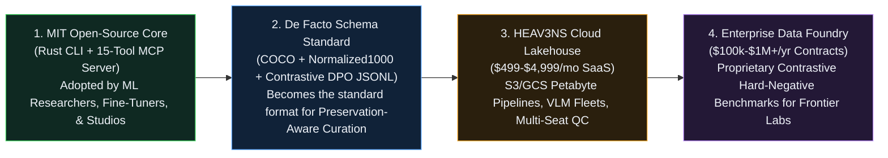

[🏠 Home (`README.md`)](../../README.md) &rsaquo; [📚 Docs (`docs/`)](../README.md) &rsaquo; [🚀 YC Package (`docs/yc/`)](README.md) &rsaquo; **04: GTM, Business Model, & Defensibility Moat**

---

# Go-To-Market, Open-Core Monetization, & Defensibility Moat

**Target Comparables:** **Roboflow (YC S20)**, **Scale AI (YC S16)**, **Supabase (YC S20)**, **Voxel51 FiftyOne**, **Cleanlab**

---

## 1. The Open-Core Flywheel: Why `MIT` Open Source Accelerates Enterprise Revenue

A common question from seed investors is: *"Why open-source the core Rust engine (`heav3ns-censor`) under the MIT License?"*

In developer infrastructure and ML data tooling, **open-source adoption is the lowest-CAC distribution channel on earth**:

---

## 2. Three-Tier Product & Pricing Matrix

| Feature / Capability | **Community (`MIT` OSS)** | **Studio & Lab Pro (`$499–$2,499/mo`)** | **Enterprise & Frontier Foundry (`$100k+/yr`)** |
| :--- | :--- | :--- | :--- |
| **Core Rust Pixel & SDF Engine (`heav3ns-censor`)** | ✅ Local CLI & Single-Node MCP | ✅ Hosted Cloud Workers (Auto-Scaling) | ✅ Dedicated VPC / On-Premise Rust Cluster |
| **Bit-Exact Preservation & Multi-Scale JPEG Audit** | ✅ Local verification | ✅ Automated CI/CD Dataset Gate | ✅ Cryptographic Compliance SLA & EU AI Act Audit Trail |
| **Contrastive Dataset Exports (`COCO`, `JSONL`, `SFT`, `DPO`)** | ✅ Local `ledger/` export | ✅ Direct HuggingFace Hub / S3 / Snowflake Sync | ✅ Custom RLHF / DPO Alignment Pipelines |
| **Autonomous VLM Triage Fleet** | Bring Your Own VLM (via MCP) | ✅ Included (`100k–1M` images/mo) | ✅ Custom Fine-Tuned Specialist Grounding Models |
| **Collaborative Human Escalation Queue (`dashboard`)** | Single-file local `dashboard.html` | ✅ Multi-seat RBAC Studio Portal + Slack/Webhook Alerts | ✅ Managed Artist-in-the-Loop QA Workforce |
| **Pre-Curated Contrastive Hard-Negative Datasets** | Sample 1K Benchmark | 50K Curated Confuser Pack | ✅ **Full Proprietary `HEAV3NS-1M-Contrastive` License** |

---

## 3. Four Compounding Moats (Why Big Tech / OpenAI Won't Just Clone This)

1. **The Contrastive Hard-Negative Data Moat:**
   - Anyone can prompt GPT-4o on an image, but general VLMs struggle with fine-grained artistic vs. explicit boundary boxes and hallucinate coordinates.
   - Every image processed through HEAV3NS Cloud and verified by human artists/curators generates paired **`(positive_intervention, verified_benign_hard_negative)`** coordinates with `fp_hardness_score` and `(chosen, rejected)` `DPO` triples. This creates the world's largest proprietary dataset of **visual false-positive confusers**.
2. **Deterministic Rust Verification & Cryptographic Provenance (`SHA-256`):**
   - Enterprise legal and compliance teams cannot rely on probabilistic Python diffusion scripts when certifying that a training dataset or published media catalog complies with Article 175, platform policies, or HIPAA/PHI redaction rules. Our deterministic pixel engine guarantees `non_censored_pixel_diff_count == 0` and `survives_publication_resize == true` down to `540p` JPEG thumbnails.
3. **Agentic MCP Ecosystem Lock-In:**
   - By shipping a 15-tool JSON-RPC 2.0 MCP server (`heav3ns-censor mcp-stdio`), our coordinate system (`Normalized1000` + burned-in cyan/yellow/pink anchor grids + $3\times$ zoom crops) becomes the native visual grounding interface for autonomous curation agents.
4. **Domain Credibility with the Creative & Research Community:**
   - Because HEAV3NS was born inside an actual art studio (`MAJO` & `EGG`) under a strict **Artistic Preservation Mandate**, artists and cultural institutions trust us to curate and protect visual heritage without generative distortion.

---

## 4. 90-Day YC Batch Execution Roadmap (Weeks 1 to 12)

| Phase | Timeline | Milestone | Target Metric |
| :--- | :--- | :--- | :--- |
| **Phase 1: Benchmark Launch** | **Weeks 1–3** | Curate and open-source **`HEAV3NS-ArtSafety-10K`** on Hugging Face (10,000 classical & figurative artworks falsely flagged by `NudeNet`/`OpenNSFW`, restored with Contrastive Hard-Negative `COCO` & `DPO` annotations). | `#1` Trending Dataset on Hugging Face + `2,500+` GitHub Stars |
| **Phase 2: Cloud API Beta** | **Weeks 4–7** | Launch hosted **HEAV3NS Cloud Curation API** (`POST /v1/curate-batch`) with S3 bucket ingestion and automated VLM grounding + Rust verification workers. | `10` paying AI startups / fine-tuning studios (`$15k` MRR) |
| **Phase 3: Frontier Lab Pilots** | **Weeks 8–12 (Demo Day)** | Sign paid dataset licensing & compliance pipeline pilots with foundation model teams and major generative art platforms. | `$40k+` MRR (`$500k` annualized run-rate) by Demo Day |

