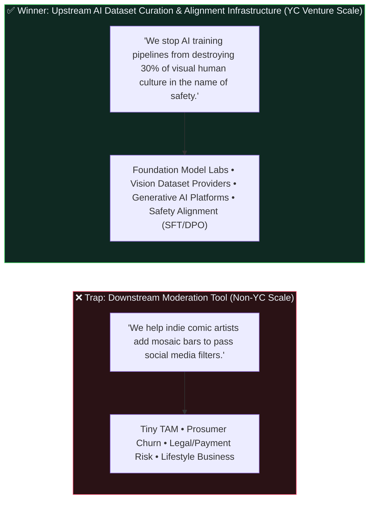

[🏠 Home (`README.md`)](../../README.md) &rsaquo; [📚 Docs (`docs/`)](../README.md) &rsaquo; **🚀 Y Combinator Diligence, Application, & Seed Pitch Package (`docs/yc/`)**

---

# HEAV3NS-CENSOR: Y Combinator (`ycombinator.com/apply`) Diligence & Seed Pitch Package

> **Executive Verdict:** **YES — Conditionally YC-Shaped (`8.8 / 10` as Upstream AI Dataset Curation & Multimodal Safety Alignment Infrastructure; `3.2 / 10` if pitched too far downstream as a niche artist censorship utility).**
>
> When positioned at the **top of the generative AI data supply chain**—solving **Sample-Dropping Bias (`15%–40%` false-positive erasure of figurative art & anatomy)** and **Generative Inpainting Poisoning** via **Contrastive Dual-Polarity Grounding, Deterministic Zero-Collateral Rust Pixel Engineering, and VLM `SFT`/`DPO` Preference Exports**—`heav3ns-censor` sits squarely inside Y Combinator's highest-conviction AI Infrastructure & Data Curation thesis alongside **Scale AI (YC S16)**, **Roboflow (YC S20)**, and **Astral / Ruff**.

---

## 📂 Package Contents (`docs/yc/`)

| Document | Purpose & Audience | Key Deliverable |
| :--- | :--- | :--- |
| **[`00-ORIGIN-INSIGHT-AND-THESIS.md`](00-ORIGIN-INSIGHT-AND-THESIS.md)** | **Foundational Upstream Thesis (`arXiv:2409.17156`)** | Why moving upstream from moderation SaaS to **Preservation-Aware Dataset Curation** solves Sample-Dropping Bias and Inpainting Poisoning for Generative AI. |
| **[`01-YC-VIABILITY-AND-PARTNER-DILIGENCE-REPORT.md`](01-YC-VIABILITY-AND-PARTNER-DILIGENCE-REPORT.md)** | **Objective YC Partner Investment Memo & Rubric Assessment** | Candid analysis of why downstream moderation SaaS gets rejected by YC, why **Preservation-Aware Dataset Curation** is a venture-scale category, a 7-pillar YC Partner scorecard, red flags to avoid, and empirical grounding (`arXiv:2409.17156`). |
| **[`02-YC-SEED-PITCH-DECK.md`](02-YC-SEED-PITCH-DECK.md)** | **12-Slide YC Demo Day & Seed Investor Pitch Deck (Markdown)** | Slide-by-slide narrative, visual architecture diagrams, unit economics, market sizing (`$14.8B` AI Data Curation & Compliance TAM), and speaker notes. |
| **[`pitch_deck.html`](pitch_deck.html)** | **Interactive Browser Presentation Deck (Zero-Dependency HTML/JS)** | Keyboard-navigable (`←` / `→` / `Space`, `f` fullscreen, `g` grid overview) dark-mode studio presentation deck ready for live founder demos and partner meetings. |
| **[`03-YC-APPLICATION-BLUEPRINT.md`](03-YC-APPLICATION-BLUEPRINT.md)** | **Complete `ycombinator.com/apply` Application Blueprint & Interview Prep** | Exact character-counted answers (`<= 50` char description: `Preservation-aware visual dataset curation for AI`, `49 chars`), founder-market fit framing, traction proof, and 10-minute YC Partner interview Q&A gauntlet. |
| **[`04-GTM-BUSINESS-MODEL-AND-MOAT.md`](04-GTM-BUSINESS-MODEL-AND-MOAT.md)** | **Open-Core Commercialization, Pricing Tiers, & Defensibility Moat** | How an `MIT`-licensed Rust engine monetizes like **Roboflow (YC S20)**, **Supabase (YC S20)**, and **Hugging Face**: Open-Source CLI/MCP $\rightarrow$ Petabyte Cloud Curation API $\rightarrow$ Proprietary Contrastive Hard-Negative Benchmarks. |

---

## 🎯 The Strategic Pivot That Makes This YC-Backable (From [`yc.md`](../../yc.md))

### The 3 Non-Negotiable Rules When Pitching to Y Combinator
1. **Never pitch this as a "censorship tool" or "social media NSFW filter."** Pitch it as **Preservation-Aware Visual Dataset Curation & Contrastive Safety Alignment Infrastructure**.
2. **Lead with the two mathematical failure modes of current AI data pipelines:**
   - **Failure Mode 1 — Sample-Dropping Bias:** Coarse classifiers (`NudeNet`, `OpenNSFW`, `LAION-Safety`) misclassify `15%–40%` of legitimate figurative art, classical sculpture, and medical/anatomical studies (`arXiv:2409.17156`), causing foundation model teams to delete millions of high-value training images.
   - **Failure Mode 2 — Generative Inpainting Poisoning:** Attempting to "heal" sensitive regions with diffusion inpainting corrupts non-target pixels (`> 0` exterior drift) and injects synthetic latent hallucinations into pre-training corpora.
3. **Make the Artist-Founder identity your unfair secret weapon:** Most AI safety engineers treat images as disposable tensors and cannot tell the difference between a Bernini sculpture contour, a garment seam, and explicit content. An artist-engineer founder who built a zero-collateral Rust pixel engine with mathematical proof (`non_censored_pixel_diff_count == 0`, multi-scale JPEG resilience, and contrastive `DPO` exports) has **authentic, earned founder-market fit**.

